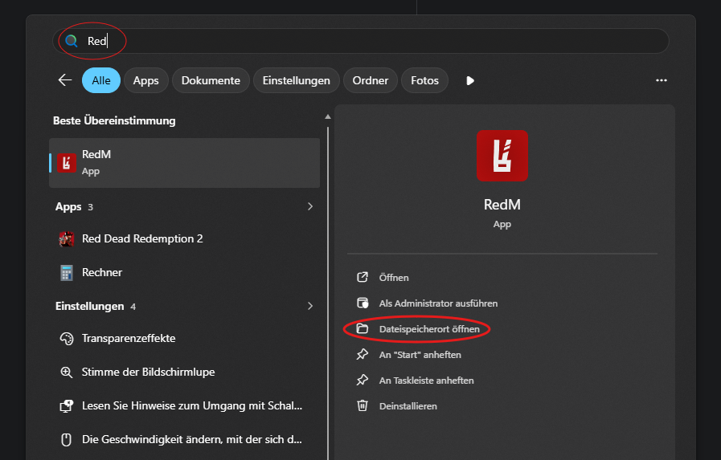
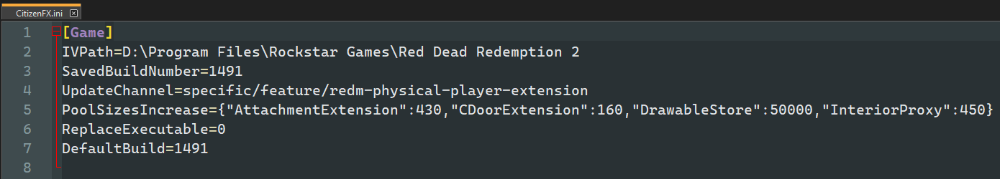

# 128-Spieler-Änderung seit 16.10.2026

<Badge type="danger" text="Der Server kann nur mit diesem Update Channel betreten werden."/>

### Wie finde ich meinen RedM-Ordner?

Drücke die Windows Taste und suche nach RedM. Drücke dann auf `Dateispeicherort öffnen`.
Sollte eine erneute Verknüpfung auftauchen, mach einen Rechtsklick und wähle erneut `Dateispeicherort öffnen`.

### 1. Schritt

Geht in den Ordner, wo RedM installiert ist öffnet den Ordner `RedM Application Data`.

### 2. Schritt

Öffnet die Datei `CitizenFX.ini`.

### 3. Schritt

Ändere den UpdateChannel auf `specific/feature/redm-physical-player-extension`.

### 4. Schritt

Speichere die Datei und starte RedM neu.